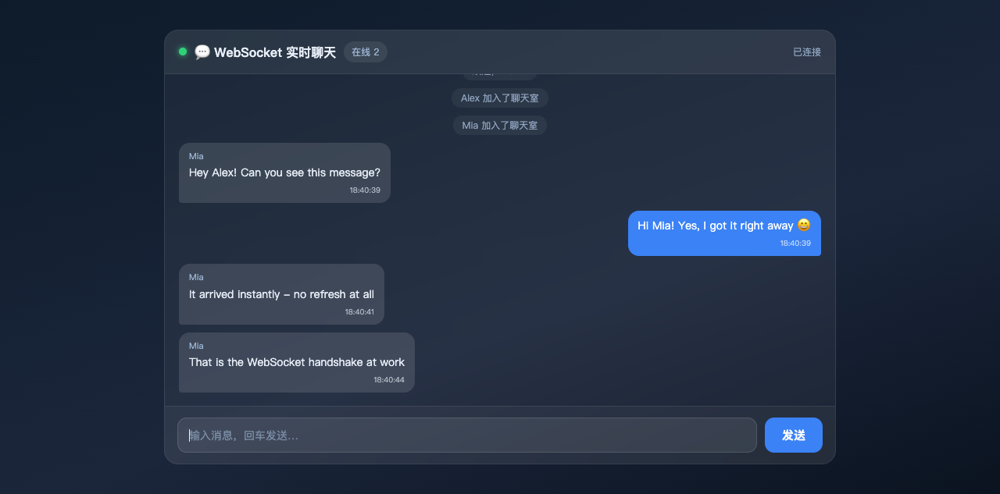

# WebSocket 实时聊天室 (ws-chatroom)

**纯 Python 标准库手写 WebSocket 协议**的多人实时聊天室——网络编程课程项目。
不用任何第三方框架，从 TCP socket 开始实现 HTTP 升级握手、帧解析、多线程广播。



## 为什么手写协议

课程目标是理解协议本身，所以刻意避开 `websockets`/`aiohttp` 等库：

- **HTTP Upgrade 握手**：`Sec-WebSocket-Key` → SHA1 + Base64 → `Sec-WebSocket-Accept`
- **RFC 6455 帧解析**：FIN / opcode / MASK / 7-16-64 位变长长度，客户端掩码解码
- **单端口复用**：同一端口先嗅探请求，HTTP 页面与 WebSocket 升级共存
- **多线程广播**：每连接一线程，写锁保护，断线自动剔除

## Features

- 多人实时聊天、在线列表、加入/离开通知
- 账号系统：浏览器本地凭据 + 服务端 SHA-256 身份，支持多账号切换与旧标签页身份沿用
- **SQLite 消息持久化**：保留最近 2000 条，进房推送最近 50 条
- 聊天记录页：按昵称/内容搜索、向前翻页
- 跨平台启动脚本（macOS / Windows），控制台强制 UTF-8 防 GBK 乱码

## Quickstart

```bash
python3 ws_server.py     # 打开 http://localhost:8765
python3 test_broadcast.py   # 广播行为测试
python3 test_client.py      # 协议客户端测试
```

## Architecture

```
browser (index.html, vanilla JS)
   │  ws://host:8765  (same port as HTTP page)
   ▼
ws_server.py
 ├─ HTTP sniff → static page / Upgrade handshake
 ├─ frame codec (RFC 6455: FIN/opcode/mask/len)
 ├─ room state (online list, join/leave broadcast)
 └─ SQLite history (accounts / messages, ring-buffer 2000)
```

## 私隐说明

仓库不含任何真实聊天记录数据库（`chat.sqlite3` 运行时生成，已 gitignore）；
截图为课程演示用的虚构对话（Alex / Mia）。

## License

MIT
